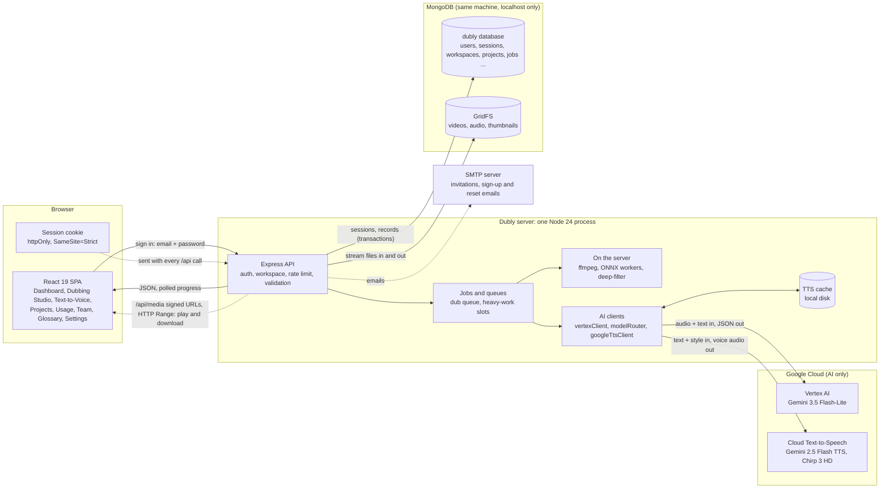

# Dubly: Architecture and AI Models

Dubly takes a video of up to 60 minutes, transcribes it, translates it into up to 10 of 45 languages, voices every line and renders the dubbed video.

**Scope of this document.** It describes Dubly running entirely on Google Cloud: `TTS_ENGINE=cloud` (the default) and no `GEMINI_API_KEY`. Every AI call goes to Vertex AI or Cloud Text-to-Speech on the service account, or runs on the Dubly server itself. The Gemini API (key based) voices in the code are not part of this setup and are left out.

Diagrams are Mermaid, so they render on GitHub and in any Markdown viewer with Mermaid support.

---

## 1. At a glance

| | |
|---|---|
| Frontend | React 19, Vite, Tailwind (`src/`) |
| Backend | Express 4 on Node 24, run with `tsx` (`server/`). One process that also serves the built frontend |
| Data | MongoDB (replica set): accounts and sessions, records, files in GridFS |
| AI | Gemini 3.5 Flash-Lite on Vertex AI; Gemini 2.5 Flash TTS and Chirp 3 HD on Cloud Text-to-Speech; three models on the server (Silero VAD, SCRFD, DeepFilterNet3) |
| Media | ffmpeg and ffprobe |
| Hosting | One Windows PC in the office, reached through a Cloudflare Worker and tunnel |

---

## 2. The whole system

The browser only talks to the Dubly server. The server holds the data, runs the jobs and is the one place that calls an AI model.

### Request path

Every `/api` call passes through the same chain in `server/app.ts`:

1. Request id and access log
2. gzip compression, security headers, CORS
3. JSON body parser (2 MB limit)
4. `requireAuth`: looks the session up in MongoDB (and refuses cross-site changes sent with the cookie)
5. `requireWorkspace`: resolves the caller's workspace and role from the server's own membership lookup
6. The route, with rate limits and zod validation
7. The error normaliser, which keeps internal details out of responses

### Routes

| Mount | What it does |
|---|---|
| `/api/projects` | create, list, get, progress, edit, delete; upload, import sample, face scan; transcribe; translate; edit translated lines |
| `/api/projects/:id/dub`, `/retake`, `/export-video` | start a dub, re-render one language, burned-in captions |
| `/api/projects/:id/jobs` | job status and cancel |
| `/api/projects/:id/share`, `/api/share/:token` | private share links, and the public viewer (no sign-in) |
| `/api/tts/generate` | one-off voice clip for Text-to-Voice and previews |
| `/api/workspace`, `/api/invites`, `/api/invite-signup` | members, invitations, glossary |
| `/api/settings`, `/api/usage`, `/api/bootstrap`, `/api/profile` | preferences, minutes used, first-load data, sign out everywhere |
| `/api/healthz`, `/api/health` | liveness and status |

---

## 3. What happens in each studio step

The Dubbing Studio has five steps. Each is a call to the server, and the long ones run as jobs that the browser polls.

| # | Step | Call | What the server does | Models |
|---|---|---|---|---|
| 1 | **Upload** | `POST /upload` or `/import-sample` | Checks the file by its content, not its name. Refuses videos over 60 minutes. Cuts a thumbnail, stores the video in Cloud Storage, and scans for faces while the file uploads. | SCRFD |
| 2 | **Understand** | `POST /transcribe` (a job) | Waits for a heavy-work slot. Extracts 16 kHz audio and sends 28-second chunks to Gemini. Removes filler loops, snaps lines onto the real speech, and gives every speaker a voice. | Gemini 3.5 Flash-Lite, Silero VAD |
| 3 | **Localize** | `POST /translate` | Translates into each chosen language, three at a time, using the glossary, speaker gender and the script rule for that language. Lines in the wrong script are asked for again. Editors can fix any line. | Gemini 3.5 Flash-Lite |
| 4 | **Voice** | `POST /dub` (answers 202 with a job id) | Reserves the minutes, queues the job and renders each language (section 4). The studio shows progress while it runs. | Gemini 2.5 Flash TTS, Chirp 3 HD, DeepFilterNet3, plus Gemini for extras |
| 5 | **Export** | `export-video`, `share`, `retake` | Downloads the dubbed MP4 or WAV and SRT or VTT captions. Burned-in captions render in the background while the browser polls. A share link works for 24 hours. A retake redoes only the lines that changed. | ffmpeg |

### Transcription job in detail

1. Wait for a heavy-work slot, download the video, extract 16 kHz audio.
2. Send the audio to Gemini in 28-second chunks. The first chunk runs alone and fixes the language and the first speakers' voices. The rest run three at a time, each given short voice samples of speakers already heard so "Speaker 1" means the same person in every chunk. A chunk that fails gets a second attempt.
3. Remove hallucinated filler (the same short phrase repeated on non-speech audio).
4. Silero VAD finds where speech physically is. The transcript lines are re-timed onto those regions chunk by chunk, so a chunk that came back short cannot pull other lines out of place.
5. Assign speakers a voice of their own gender, then save the transcript.

---

## 4. Inside a dub job

Shared preparation runs once. Then every chosen language goes through the same render loop. Dashed boxes only run when a setting or paid extra is switched on.

```mermaid
flowchart TD
  subgraph ONCE["Once per job, shared by every language"]
    A1["Download the source video"] --> A2["Split voice from background<br/>DeepFilterNet3, when the option is on<br/>stems cached for later runs"]
    A2 --> A3["Measure every original line<br/>when speech starts and stops, how loud"]
    A3 --> A4["Source loudness target<br/>and the face scan from upload"]
  end

  A4 --> B1

  subgraph EACH["For each language, one after another"]
    B1["Hinglish only<br/>Gemini rewrites the line in Devanagari"] --> B2["Voice every line<br/>cache, then Gemini 2.5 Flash TTS or Chirp 3 HD"]
    B2 --> B3["Pace re-take<br/>extra: a line that overruns is voiced again with a pace note"]
    B3 --> B4["Condense long lines<br/>Gemini shortens lines that still overrun, then re-voices"]
    B4 --> B5["AI review<br/>extra: Gemini listens to the original and the dub, 8 lines per request"]
    B5 --> B6["Re-record flagged lines<br/>extra: one retry per line, kept only if approved"]
    B6 --> B7["Set line levels<br/>whispers stay quiet, shouts stay loud"]
    B7 --> B8["Place each take<br/>at the speaker's real start, fitted to the mouth if faces were found"]
    B8 --> B9["Render and mix<br/>voice track over the ducked background, loudness matched"]
    B9 --> B10["Mux and upload<br/>MP4 with a caption track to Cloud Storage, progress saved"]
  end

  B10 --> Z["Settle the job<br/>bill the languages that rendered, refund the rest"]

  classDef ai fill:#FFF1ED,stroke:#E04A2B,color:#0F172A;
  classDef local fill:#E4F6F3,stroke:#0D9488,color:#0F172A;
  classDef opt stroke-dasharray:5 4;
  class B1,B2,B3,B4,B5,B6 ai;
  class A2 local;
  class A2,B3,B5,B6 opt;
```

Coral boxes call a Google-hosted model, teal boxes run a model on the server.

Points that matter:

- **One language failing does not stop the others.** Each finished language is saved as soon as it is done, so it can be downloaded while the rest render.
- **Lines are placed on the original speaker's measured start**, so the voice never arrives before the lips. When the face scan found a speaker on screen, lines are also paced to fit the mouth.
- **Separated stems are cached** in the project's storage. Retakes and extra languages reuse them. If separation is unavailable or fails, the original audio is ducked under the dub instead.
- **A retake** is an ordinary dub job for one language. It is charged only for lines whose text, delivery or voice changed since the last render. The TTS cache makes the unchanged lines free to re-voice.
- **Captions** ride along as a switchable subtitle track in every export. Burned-in captions are rendered separately with ffmpeg and libass, and need fonts for every script dubbed into.

---

## 5. Jobs, queues and reliability

Every dub and transcription is a job document in MongoDB (`jobs`), implemented in `server/lib/jobs.ts`.

| Concern | How it is handled |
|---|---|
| One operation per project | `project.activeJobId`, checked in the same transaction that creates the job. A double click or a second teammate gets `409` |
| Double charging | A dub's minutes are reserved in that same transaction. Replaying an `Idempotency-Key` returns the original job |
| Only the owner writes | Every progress or result write checks `activeJobId` inside its transaction |
| Crash or restart | The runner updates a heartbeat every 15 seconds. A sweep at startup and every 60 seconds fails jobs with a stale heartbeat and refunds their minutes. Dubs that had not started are re-queued |
| Exactly-once refunds | `settleJob` records the outcome, refunds and releases the project in one transaction, once |
| Cancel and timeout | `cancelRequested` is checked inside every progress write. Transcriptions also time out after 45 minutes |
| Shutdown | On SIGTERM the server stops taking work, releases queued dubs, waits up to 25 seconds for running ones, then settles the rest as interrupted with a refund |

Admission control (`server/lib/dubQueue.ts`, `heavyWork.ts`): dubs wait in an in-process queue with a limit per workspace and per server. Transcriptions and caption renders share a small number of heavy-work slots. A request waits up to 10 minutes for a slot, then gets `503 SERVER_BUSY`. The limits come from environment variables (`MAX_DUBS_PER_WORKSPACE`, `MAX_ACTIVE_DUBS`, `MAX_HEAVY_REQUESTS`).

Housekeeping: hourly sweeps remove stale scratch files and expired records.

Keeping one machine fast: the ONNX models run in worker threads so they cannot freeze the API, progress polls read one small document, progress writes are throttled, and responses are gzip-compressed.

---

## 6. Workspaces and plans

- A **workspace** owns projects and the monthly minute allowance. Every project path is `workspaces/{workspaceId}/projects/{id}`, and the workspace id always comes from the server-side membership lookup, never from the browser.
- Each person belongs to exactly one workspace at a time, as `admin` or `editor`. A first-time user gets a personal workspace.
- Teams form by **invitation**: an admin creates a link, emailed when SMTP is configured, and the invitee accepts it while signed in with the invited email.
- The **plan** (`plans` collection in MongoDB) sets the monthly minutes, whether paid extras and invitations are available, and which voice engines can be picked.

With the Google Cloud setup, the default plans work out like this:

| | Starter | Enterprise |
|---|---|---|
| Minutes per month | 50 | 120 |
| Voices that can be picked | Gemini 2.5 Flash | Gemini 2.5 Flash, Chirp 3 HD |
| Paid extras | none | AI review, pace re-takes |
| Team invitations | no | yes |

Each extra an Enterprise user switches on makes every dubbed minute use more of the allowance (AI review +0.25, pace re-takes +0.25). The rate is fixed when the dub is charged and stored on the job, and refunds use the same rate. Extras are off by default because each one adds to the provider bill.

---

## 7. Where it runs

- **One machine.** The office PC runs the Node process on `127.0.0.1:8787` next to its local MongoDB; `deploy/local-prod/run.ps1` keeps both running. People reach it at `https://dubly.scatterpie.workers.dev`, a Cloudflare Worker that forwards to a Cloudflare tunnel. Only one instance can run, because the queues, rate limits and caches live in memory. The same app also builds as one Docker image.
- **Checked, not deployed, by GitHub.** Push to `main` and CI plus the Release gate test it (correctness, performance and model-call budgets, security). The PC is updated by hand once both are green (DEPLOYMENT.md).
- **Credentials.** Key files in `server/credentials/` (or `CREDENTIALS_DIR`). On a Google host, `CREDENTIALS_MODE=adc` would use its service account and no key files.

---

# AI models

Six models in total. Three are hosted by Google and called over the network. Three run on the Dubly server itself. The browser never calls any of them.

| # | Model | Where it runs | Used for |
|---|---|---|---|
| 1 | **Gemini 3.5 Flash-Lite** | Vertex AI, global endpoint | Speech-to-text, translation, Hinglish script, line condensing, AI review |
| 2 | **Gemini 2.5 Flash TTS** | Cloud Text-to-Speech | The expressive voices, which follow emotion and delivery |
| 3 | **Chirp 3 HD** | Cloud Text-to-Speech | Steady studio voices, and the safety net for every other voice |
| 4 | **Silero VAD v5** | Dubly server (ONNX) | Finding the real speech regions in the audio |
| 5 | **SCRFD 2.5G** | Dubly server (ONNX) | Detecting faces |
| 6 | **DeepFilterNet3** | Dubly server (binary) | Separating the speaker from music and ambience |

## Functions and the model behind each

The function names are in `server/lib`.

### Reading and rewriting text: Gemini 3.5 Flash-Lite

| Function | Code | What it does | When it runs | Env var |
|---|---|---|---|---|
| Speech-to-text | `vertexTranscribe` | Listens to the audio in 28-second chunks. Returns the spoken language, the exact words in the native script, who is speaking (gender and age), how each line is delivered, and laughs or sighs | Every transcription | `GEMINI_STT_MODEL` |
| Translation | `vertexTranslateSegments` | Translates every line into each target language in the chosen style, using the glossary, speaker gender and the script rule. Asks again for lines in the wrong script or in Hindi instead of the dialect | Every translation | `GEMINI_TRANSLATE_MODEL` |
| Hinglish speech script | `vertexHinglishToSpeechScript` | Rewrites romanized Hinglish into Devanagari so the Hindi voices read it correctly | Hinglish dubs only | `GEMINI_TRANSLATE_MODEL` |
| Line condensing | `vertexCondenseLine` | Shortens a dubbed line that is still too long for its slot, then the voice records it again | When a line does not fit | `GEMINI_TRANSLATE_MODEL` |
| AI review | `reviewDubbedLines` | Listens to each dubbed line next to the original, 8 lines per request and 3 requests at once. Flags garbled speech, missing words, mispronunciation, the wrong language or the wrong emotion. A flagged line is re-recorded once and kept only if the reviewer accepts it | Paid extra, off by default | `GEMINI_REVIEW_MODEL` |

### Speaking the dub: Cloud Text-to-Speech

| Function | Code | What it does | When it runs |
|---|---|---|---|
| Voice synthesis | `routeSynthesizeSpeech`, `googleSynthesizeSpeech` | Voices each dubbed line, the Text-to-Voice Studio and voice previews. Checks the local TTS cache first, tries the voice engines the plan allows in order, and falls back to Chirp 3 HD so a dub does not fail when a model is out of quota | Every dub, preview and Text-to-Voice clip |

### Analysing audio and video: models on the Dubly server

| Function | Code | Model | What it does | When it runs |
|---|---|---|---|---|
| Speech detection | `detectSpeechRegionsVad` | Silero VAD v5 | Finds where people really speak, so transcript lines snap onto the actual speech instead of Gemini's drifting timestamps. Runs in a worker thread | Every transcription. Without the model file it falls back to plain silence detection |
| Face scan | `scanFaces` | SCRFD 2.5G | Samples frames across the video at upload and records whether a speaker is on screen. If one is, dubbed lines are fitted to the mouth | Every upload, best effort. The studio can ask again later |
| Speech separation | `separateStems` | DeepFilterNet3 | Splits the soundtrack into the voice and everything else, so the dub replaces only the speaker. Stems are cached per project | When the option is on. If it is unavailable or fails, the original audio is ducked instead |

## Model details

### 1. Gemini 3.5 Flash-Lite
- **Model id:** `gemini-3.5-flash-lite`
- **Served by:** Vertex AI, location `global` (Gemini 3.x is only served from the global endpoint)
- **Used for:** speech-to-text, translation, Hinglish script, condensing, AI review
- **Status:** always on. The AI review is a paid extra
- **Set by:** `GEMINI_STT_MODEL`, `GEMINI_TRANSLATE_MODEL`, `GEMINI_REVIEW_MODEL`, `VERTEX_PROJECT_ID`, `VERTEX_GEMINI_LOCATION`

### 2. Gemini 2.5 Flash TTS
- **Model id:** `gemini-2.5-flash-tts`
- **Served by:** Google Cloud Text-to-Speech, on the service account
- **Used for:** the expressive voices. They follow the project's emotion and each line's delivery, which transcription hears in the original. Laughs and sighs are performed from tags
- **Status:** the default voices (`TTS_ENGINE=cloud`)
- **Set by:** `GEMINI_TTS_CLOUD_MODEL`
- **Limits:** the default Vertex AI quota is about 10 requests a minute, and past it lines fall back to Chirp 3 HD, so production needs a raised quota. A request is limited to 4,000 bytes of text. Cloud TTS refuses some locales for Gemini voices, so those lines are read under the related language's locale, such as Bhojpuri under Hindi. Bengali is sent as `bn-BD`, because the model refuses `bn-IN`

### 3. Chirp 3 HD
- **Voice names:** `<locale>-Chirp3-HD-<persona>`
- **Served by:** Google Cloud Text-to-Speech (the generally available service, with production quotas)
- **Used for:** steady studio voices for the major Indian languages, and the fallback for every other voice. It does not perform laughs and sighs, so those tags are stripped
- **Status:** a pickable voice on Enterprise, and always the safety net. A line another model cannot voice (out of quota, unreachable, refused) is voiced by the same persona on Chirp 3 HD rather than failing the dub
- **Fallback for languages it does not speak:** the related language's voice reads the script (Hindi for Bhojpuri, Bengali for Assamese, Urdu for Sindhi)

Gemini 2.5 Flash TTS and Chirp 3 HD share one voice roster (Aoede, Charon, Kore and so on), so a persona sounds the same on either. There are 30 personas.

### 4. Silero VAD v5
- **File:** `server/models/silero_vad.onnx` (about 2 MB)
- **Runs on:** the Dubly server, ONNX Runtime, in a worker thread
- **Used for:** telling human speech from applause, music and noise, so transcript lines land on real speech

### 5. SCRFD 2.5G with keypoints
- **File:** `server/models/scrfd_2.5g_bnkps.onnx` (about 3 MB)
- **Runs on:** the Dubly server, ONNX Runtime, in a worker thread
- **Used for:** the face scan stored on the project. When a speaker is on screen, every line is paced to fit the mouth

### 6. DeepFilterNet3
- **File:** the `deep-filter` static binary, v0.5.6 (`server/bin/deep-filter.exe` on the PC, pinned by hash in the Dockerfile)
- **Runs on:** the Dubly server, one CPU core, in 5-minute chunks so memory stays flat however long the video is
- **Used for:** separating the speaker from the background. It is built for noise rather than music, so a loud music bed can keep a trace of the voice

## How a line picks its voice

Before any model is called, the local TTS cache is checked. The same text, voice, style and model is never voiced twice. Then the models are tried left to right and the first one that works voices the line.

| Voice the user picked | Models tried, in order |
|---|---|
| Gemini 2.5 Flash voice | Gemini 2.5 Flash TTS, then Chirp 3 HD |
| Chirp 3 HD voice | Chirp 3 HD where it speaks the language. Otherwise Gemini 2.5 Flash TTS, then Chirp 3 HD in the related language |
| Any voice, with `TTS_ENGINE=chirp` | Chirp 3 HD only |

Rules around it:

- The plan decides which voices can be picked. A voice outside the plan is voiced as the same persona on an engine the plan includes.
- A model that is out of quota is skipped for 90 seconds. One that is withdrawn or not permitted is skipped for 30 minutes. A language refused three times in a row is skipped for that model.
- Rate limits and 503s are retried after 4, 10 and 20 seconds before the call is given up. Vertex AI calls for text retry after 1, 3 and 8 seconds.
- **Odia** has no Chirp 3 HD voice, so it is voiced only by Gemini 2.5 Flash TTS. When that model is out of quota the line goes back to the retry instead of failing on Chirp.
- **Santali** has no Cloud TTS voice of either kind. A language no offered voice speaks is not offered as a target, and a dub, retake or Text-to-Voice request for it is refused with `LANGUAGE_NOT_VOICED`.

## Settings that choose the models

| Variable | Default | Meaning |
|---|---|---|
| `VERTEX_PROJECT_ID` | none | Google Cloud project used for Vertex AI and Cloud TTS |
| `VERTEX_GEMINI_LOCATION` | `global` | Vertex AI endpoint location |
| `GEMINI_STT_MODEL` | `gemini-3.5-flash-lite` | Speech-to-text |
| `GEMINI_TRANSLATE_MODEL` | `gemini-3.5-flash-lite` | Translation, Hinglish script, condensing |
| `GEMINI_REVIEW_MODEL` | `gemini-3.5-flash-lite` | AI review |
| `TTS_ENGINE` | `cloud` | `cloud`: Gemini 2.5 Flash TTS and Chirp 3 HD. `chirp`: Chirp 3 HD only |
| `GEMINI_TTS_CLOUD_MODEL` | `gemini-2.5-flash-tts` | The Gemini voice model on Cloud TTS |
| `CREDENTIALS_MODE` | key files | `adc` uses the VM's service account and no key files |

For this setup leave `GEMINI_API_KEY` unset and keep `TTS_ENGINE` on `cloud` or `chirp`.

---

## Where to look in the code

| Area | Files |
|---|---|
| Process and app | `server/index.ts`, `server/app.ts` |
| Routes | `server/routes/projects.ts`, `dub.ts`, `jobs.ts`, `tts.ts`, `share.ts`, `workspace.ts` |
| Jobs and queues | `server/lib/jobs.ts`, `dubQueue.ts`, `heavyWork.ts`, `lifecycle.ts` |
| Gemini on Vertex AI | `server/lib/vertexClient.ts`, `translatePrompt.ts`, `dubDirector.ts` |
| Voices | `server/lib/modelRouter.ts`, `googleTtsClient.ts`, `ttsCache.ts`, `src/lib/voiceEngines.ts` |
| Local models | `server/lib/vad.ts`, `faceScan.ts`, `audioSeparation.ts`, `onnxPool.ts` |
| Audio and video | `server/lib/ffmpeg.ts` (includes loudness), `dubMix.ts`, `levelMatch.ts`, `mediaTools.ts` |
| Plans and tenancy | `server/lib/plans.ts`, `workspaces.ts`, `src/lib/planMath.ts` |
| Studio UI | `src/components/DubbingStudio/` |
